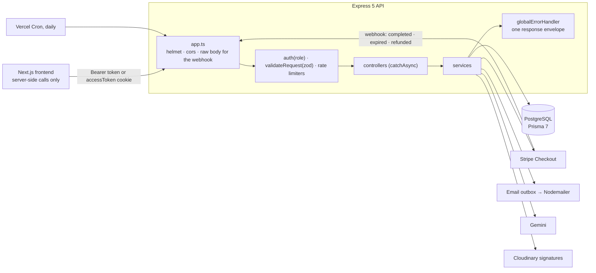
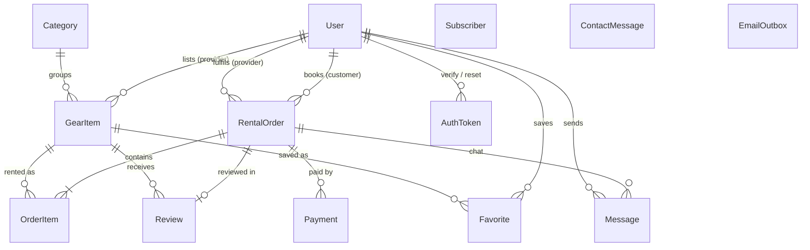

<div align="center">

# GearUp API

**The REST API behind GearUp, a gear rental marketplace for Bangladesh.**

Providers list sports and outdoor gear, customers book it by the day and pay through Stripe with a refundable deposit, and admins settle claims and watch the numbers. It counts availability per day so nothing is overbooked, sends email in English or Bangla, and grounds every AI answer in real data.

[](https://gear-up-backend-two.vercel.app/)
[](https://gear-up-frontend-chi.vercel.app/)
[](https://github.com/abdullahmamun1/gearUp-frontend)


</div>

## Table of contents

- [What the API solves](#what-the-api-solves)
- [Architecture](#architecture)
- [Data model](#data-model)
- [Tech stack](#tech-stack)
- [Guided installation](#guided-installation)
- [Troubleshooting](#troubleshooting)
- [Demo data and accounts](#demo-data-and-accounts)
- [API overview](#api-overview)
- [AI features: how they work](#ai-features-how-they-work)
- [Core flows](#core-flows)
- [Cross-cutting behaviour](#cross-cutting-behaviour)
- [Scripts](#scripts)
- [Project structure](#project-structure)
- [Deployment](#deployment)
- [Roadmap and known gaps](#roadmap-and-known-gaps)
- [Author](#author)

## What the API solves

| Problem | How the API handles it |
|---|---|
| Two people book the last unit at the same moment | Bookings lock the gear rows (`SELECT … FOR UPDATE`) inside a transaction, so they take turns and the second one gets a clear error |
| "In stock" says nothing about your dates | `stock` is units owned and is never decremented. Free units = stock minus the most units held on any day of the range by overlapping orders |
| Requests and unpaid bookings hold gear forever | PLACED orders hold stock only until the provider's 48 h deadline, CONFIRMED ones until the 24 h payment deadline (plus 1 h grace). Availability checks the deadlines directly, so it never waits for a cleanup job |
| Two people change the same order at once | Status writes are conditional (`updateMany where status = <the status read>`), so the loser gets a 409 instead of overwriting |
| A payment arrives late or for a cancelled order | Only the signed Stripe webhook marks an order PAID. A late or orphaned payment is refunded automatically |
| A retried refund pays out twice | Every refund uses a Stripe idempotency key (`cancel-refund-…`, `deposit-refund-…`, `claim-refund-…`, `late-payment-refund-…`) |
| Damage after a rental | A deposit is charged with the rental. The provider releases it or files a claim, and an admin keeps all, part or none, capped at the deposit |
| Emails get lost or sent twice | Emails go into an outbox in the same transaction as the change, with a unique `dedupeKey`, and are retried with backoff |
| Strangers learn where a provider lives | Public responses round the provider's location to about 1 km. The exact point is returned only to a customer with a paid order |
| AI answers invent gear or prices | Replies are validated against a Zod schema, unknown ids are dropped, categories are mapped to real ones and prices are clamped to the category's normal range |
| The frontend's servers share one IP | Limits that protect an account key on IP plus email. AI limits key on the user or the visitor IP the frontend forwards |

## Architecture



Every module follows the same path: **route** (`auth(Role.X)` → `validateRequest/Params/Query(zodSchema)`) → **controller** (`catchAsync`, thin) → **service** (Prisma, ownership checks and rules, throws `createError`) → `sendResponse`.

## Data model



- The schema is split by model in `prisma/schema/*.prisma`, and the client is generated into `generated/prisma`.
- IDs are UUIDs, money is `Decimal(10,2)`, and tables map to snake_case plural names.
- `RentalOrder.totalAmount` is the rental only. `depositAmount`, `depositStatus` and the claim fields sit beside it, and `Payment.amount` is the sum charged.
- `Review.rentalOrderId` is unique: one review per order, and only after it is returned. Hidden reviews (`isHidden`) are filtered from every public read.
- `User.locale`, `Subscriber.locale` and `ContactMessage.locale` (`en` or `bn`) pick the language of emails and AI replies.

## Tech stack

| Area | Choice |
|---|---|
| Runtime | Node.js 20+, TypeScript (ESM), Express 5 |
| Database | PostgreSQL with Prisma 7 (`@prisma/adapter-pg`, split schema) |
| Auth | JWT access and refresh tokens, bcrypt, Google OAuth with PKCE, one-time hashed tokens for email links |
| Validation | Zod 4 |
| Payments | Stripe Checkout, a signed webhook and idempotent refunds |
| Email | Nodemailer (SMTP, or a throwaway Ethereal inbox in development) with a database outbox |
| AI | Google Gemini (`@google/genai`), JSON replies checked with Zod |
| Files | Cloudinary signed direct uploads |
| Security | helmet, cors, express-rate-limit |
| Tooling | tsx, tsup |
| Hosting | Vercel (`vercel.json`), with a daily cron |

## Guided installation

Each step ends with a ✅ check. Every service below has a free tier that's enough for development.

### 1. Prerequisites

```bash
node -v          # v20 or newer
npm -v
stripe --version # https://docs.stripe.com/stripe-cli (only needed for payments)
```

✅ All three print a version.

### 2. Clone and install

```bash
git clone https://github.com/abdullahmamun1/gearup-backend-api.git
cd gearup-backend-api
npm install          # also runs prisma generate
cp .env.example .env
```

✅ `ls generated/prisma` lists the generated client.

### 3. Create the services and fill in `.env`

| Service | Where | Copy into `.env` |
|---|---|---|
| PostgreSQL | [Prisma Postgres](https://www.prisma.io/postgres) or [Neon](https://neon.tech) → connection string, or a local Postgres | `DATABASE_URL` |
| Stripe | [Dashboard](https://dashboard.stripe.com/test/apikeys) in **test mode** → secret key | `STRIPE_SECRET_KEY` (the webhook secret comes in step 6) |
| Google sign-in | [Google Cloud Console](https://console.cloud.google.com/apis/credentials) → OAuth client ID (Web), with `http://localhost:3000/api/auth/google/callback` as an authorised redirect URI | `GOOGLE_CLIENT_ID`, `GOOGLE_CLIENT_SECRET` |
| Email | A Gmail [app password](https://myaccount.google.com/apppasswords) (needs 2-step verification). Leave `SMTP_HOST` empty in development to use a throwaway Ethereal inbox | `SMTP_HOST`, `SMTP_PORT`, `SMTP_SECURE`, `SMTP_USER`, `SMTP_PASS`, `MAIL_FROM`, `ADMIN_EMAIL` |
| AI | [Google AI Studio](https://aistudio.google.com) → Get API key | `GEMINI_API_KEY` |
| Uploads | [Cloudinary](https://cloudinary.com) → dashboard → API keys | `CLOUDINARY_CLOUD_NAME`, `CLOUDINARY_API_KEY`, `CLOUDINARY_API_SECRET` |

Then generate the secrets, one for each variable:

```bash
openssl rand -hex 32   # JWT_ACCESS_SECRET
openssl rand -hex 32   # JWT_REFRESH_SECRET
openssl rand -hex 32   # CRON_SECRET
```

Set `NODE_ENV=development`, `PORT=5000`, `APP_URL=http://localhost:3000` (the **frontend** origin, used for CORS, Stripe return URLs and email links), `BCRYPT_SALT_ROUNDS=10`, `JWT_ACCESS_EXPIRES_IN=1d` and `JWT_REFRESH_EXPIRES_IN=7d`. Copy both JWT secrets into the frontend's `.env` too: they must match. `GEMINI_MODEL` and `GEMINI_THINKING` are optional.

✅ No placeholders are left: `grep your_ .env` prints nothing (the optional `GEMINI_MODEL` and `GEMINI_THINKING` may stay empty).

### 4. Create the tables and load demo data

```bash
npx prisma migrate deploy   # or npm run db:migrate -- --name <name> while changing the schema
npm run db:seed
```

✅ Migrate ends with "All migrations have been successfully applied", and the seed prints "The seed command has been executed".

### 5. Start the API

```bash
npm run dev
```

✅ `curl http://localhost:5000` prints `GearUp API is running`.

### 6. Forward Stripe webhooks (for payments)

```bash
stripe login
stripe listen --forward-to localhost:5000/api/payments/confirm
```

Copy the printed `whsec_…` into `STRIPE_WEBHOOK_SECRET`, then restart `npm run dev`.

✅ After a test checkout (card `4242 4242 4242 4242`), the `stripe listen` terminal shows `checkout.session.completed [200]`.

### 7. Start the frontend

Follow the frontend's [guided installation](https://github.com/abdullahmamun1/gearUp-frontend#guided-installation) from step 4.

## Troubleshooting

| Symptom | Fix |
|---|---|
| `EADDRINUSE` on port 5000 (macOS) | AirPlay Receiver uses it. Set `PORT=3114` and point the frontend's `BACKEND_API_URL` at `http://localhost:3114` |
| `Cannot find module '…/generated/prisma'` | Run `npx prisma generate` (it normally runs on `npm install`) |
| Users log in but the website shows them signed out | The frontend's JWT secrets differ from these. Copy both exactly and redeploy the frontend |
| CORS error in the browser | `APP_URL` must be the frontend's exact origin, with no trailing slash |
| `Error 400: redirect_uri_mismatch` from Google | The redirect URI is the **frontend's** `/api/auth/google/callback`, and it must be listed in the OAuth client exactly |
| `No signatures found matching the expected signature` | `STRIPE_WEBHOOK_SECRET` is from another `stripe listen` session or dashboard endpoint. Copy the current one and restart |
| An order stays CONFIRMED after paying | Only the webhook marks it PAID. Check that `stripe listen` is running and the event returned 200 |
| Emails never arrive | Check the SMTP values. Without `SMTP_HOST` in development, mail goes to Ethereal and the preview links are printed in the server log |
| AI endpoints answer 503 | `GEMINI_API_KEY` is missing. A 429 means the free quota ran out for now |
| `ConnectTimeoutError` reaching Google | Slow dual-stack networks. Start with `NODE_OPTIONS=--no-network-family-autoselection` |
| Uploads answer 503 | Set the three `CLOUDINARY_*` variables |
| Random failures with `npx prisma dev` | Its PGlite database breaks under concurrent queries, which background email sending makes. Use a real Postgres |

## Demo data and accounts

```bash
npm run db:seed
```

The seed is safe to run again: it never overwrites existing rows. It creates:
- **6 categories** and **48 gear items** with photos, prices, stock and deposits.
- **4 providers** in 4 cities, with areas and map pins.
- **5 customers** and **23 orders** in every status, from returned to cancelled.
- **16 payments** and **10 reviews**, so ratings and charts have data from the start.

| Role | Email | Password |
|---|---|---|
| Admin | admin@gearup.com | Password123 |
| Provider | provider1@gearup.com … provider4@gearup.com | Password123 |
| Customer | customer1@gearup.com … customer5@gearup.com | Password123 |

## API overview

71 endpoints across 18 modules, all under `/api`. A [Postman collection](./GearUp_API.postman_collection.json) is included.

| Module | Base path | Endpoints | Highlights |
|---|---|---|---|
| Auth | `/auth` | 10 | register, login, Google, refresh token, verify email, resend, forgot and reset password, `GET`/`PATCH /me` |
| Gear | `/gear`, `/provider/gear`, `/categories`, `/brands` | 9 | search with filters, gear detail, day-by-day availability, provider CRUD (`PUT` replaces the whole item) |
| Reviews | `/reviews`, `/gear/:gearId/reviews` | 2 | one review per returned order, paged list with stats |
| Provider profiles | `/providers` | 1 | public profile with stats, listings and recent reviews |
| Rentals | `/rentals` | 5 | book, my orders, spending stats, order detail with pickup point, cancel |
| Provider orders | `/provider` | 3 | orders, status changes (confirm, decline, pick up, return), earnings stats |
| Payments | `/payments` | 4 | create checkout, history, detail, Stripe webhook |
| Messages | `/rentals/:orderId/messages`, `/messages` | 4 | order chat, mark read, unread counts |
| Favourites | `/favorites` | 3 | list, save, remove (idempotent) |
| Uploads | `/uploads` | 1 | Cloudinary upload signature |
| Admin | `/admin` | 11 | users, gear (featured), rentals, categories, reviews (hide), subscribers |
| Reports | `/admin` | 3 | analytics, AI insights, CSV export |
| Claims | `/admin/claims` | 2 | deposit claims, settle |
| Inbox | `/admin/inbox` | 5 | contact messages, read, archive, AI draft, reply |
| AI | `/ai` | 3 | trip planner, listing draft, search suggestions |
| Contact | `/contact` | 1 | contact form with auto-reply |
| Newsletter | `/newsletter` | 3 | subscribe (double opt-in), confirm, unsubscribe |
| Cron | `/cron` | 1 | the daily job (needs `CRON_SECRET`) |

`GET /gear` filters: `searchTerm`, `category` (id), `brand`, `minPrice`, `maxPrice`, `isAvailable`, `from` and `to` (`YYYY-MM-DD`), `city`, `near=lat,lng` with `radius` (km), `sortBy` (`name`, `pricePerDay`, `stock`, `createdAt`, `featured`), `sortOrder`, `page` and `limit` (at most 100).

Every response uses one envelope. Paged lists put `meta` inside `data`, and errors add `errorDetails[]`:

```json
{ "success": true, "statusCode": 200, "message": "...", "data": { "data": [], "meta": { "page": 1, "limit": 10, "total": 48, "totalPages": 5 } } }
```

## AI features: how they work

Everything goes through one helper, `generateJson({ system, contents, schema })` in `src/lib/gemini.ts`. The Zod schema is sent to Gemini as the response format and used again to validate the reply. The model is `gemini-flash-lite-latest` with low thinking, which was about 5 times faster than full Flash for these tasks.

| Endpoint | What it returns |
|---|---|
| `POST /ai/gear-finder` | A short trip plan and real gear cards. The catalogue (up to 300 rentable items, filtered by date when dates are given) is cached for 5 minutes |
| `POST /ai/search-suggest` | Up to 4 precise searches for a query, cached per language and query for 10 minutes |
| `POST /ai/listing-draft` | A description, highlights, category and suggested price with a reason. Only `https://res.cloudinary.com` images are fetched (SSRF guard) |
| `GET /admin/analytics/insights` | A headline and insights explaining the range against the previous one. Cached for 30 minutes |
| `POST /admin/inbox/:id/draft` | A reply to a contact message, written only from the rental policy. It is never sent automatically |
| Review summaries (background) | `{ summary, pros, cons }` on a gear item once it has 3 visible reviews, refreshed after new reviews and by the daily job |

- **Grounding:** catalogue entries, listing notes and reviews go into prompts as quoted data ("data, not instructions"). Ids not in the catalogue are dropped, category names are mapped to real ids, and prices are clamped to the category's 10th–90th percentile.
- **Privacy:** names, emails and phone numbers are never sent.
- **Insights without AI:** rule checks find the signals first (revenue change of 25% or more, a cancellation spike, refunds of 20% or more, category concentration, sign-up growth). If Gemini fails, the rule-based text is returned with `source: "rules"`.
- **Language:** replies are written in the request's `locale` (`en` or `bn`).
- **Friendly failures:** no key → 503, quota → 429, 20-second timeout → 504, unreadable reply → 502.

## Core flows

- **Auth:**
  - Register (customer or provider), verify the email link (48 h), log in. Google sign-in counts as verified.
  - Login returns `{ accessToken, refreshToken, locale }` in the body. Send the access token as `Authorization: Bearer` or an `accessToken` cookie.
  - A password reset (30-minute link) sets `passwordChangedAt`, and tokens issued before it stop working. Suspended users get 403.
  - Customers must verify their email before paying, and providers before publishing gear.
- **Booking:** the customer picks dates (calendar days in Asia/Dhaka, half-open `[start, end)`, so the return day is free for the next renter). The order is created inside a transaction that locks the gear rows and re-checks availability. One order has one provider, and the minimum is ৳65.
- **Lifecycle:**
  ```
  PLACED ──provider confirms──▶ CONFIRMED ──webhook──▶ PAID ──▶ PICKED_UP ──▶ RETURNED
     │ 48 h, no reply              │ 24 h, unpaid           │
     ▼                             ▼                        ▼
  CANCELLED                    CANCELLED                CANCELLED (full refund until 24 h before the start day)
  ```
  Both deadlines end no later than the end of the start day. Stale orders expire lazily before order reads (at most once a minute) and in the daily job.
- **Payments:** `POST /payments/create` opens a Stripe Checkout session with two line items (rental and deposit), or reuses a pending one. The webhook handles `checkout.session.completed`, `checkout.session.expired` and `charge.refunded`.
- **Return and deposit:** on return the provider marks the condition. OK refunds the deposit. Damage moves it to `CLAIMED`, and an admin settles it as `KEPT`, `PARTIALLY_REFUNDED` or `REFUNDED`. The refund runs first, so a failed refund leaves the claim open.
- **Messages:** only the order's customer and provider can read or write. Each message queues at most one email an hour per conversation.
- **Daily cron** (02:00 UTC, 08:00 in Dhaka): expire stale orders, queue pickup reminders for tomorrow's rentals and review requests for recent returns, retry the email outbox, refresh up to 10 review summaries and purge old tokens. Every step is safe to repeat.

## Cross-cutting behaviour

- **Rate limits** (per minute):

  | Limiter | Limit | Key |
  |---|---|---|
  | `authLimiter` (login, register, forgot password) | 10 | IP + email |
  | `oauthLimiter` (Google) | 60 | IP |
  | `writeLimiter` (messages, contact, newsletter, uploads, replies) | 5 | user, or IP + email |
  | `aiLimiter` | 8 | user or visitor IP (`x-client-ip`) |
  | `aiSuggestLimiter` | 20 | user or visitor IP |
  | `aiGlobalLimiter` | 30 | the whole site |

- **Email outbox:** `emailService.enqueue(tx, …)` inside the transaction, then `dispatchSoon()` after it commits (`waitUntil` on Vercel). A unique `dedupeKey` makes queueing idempotent, failures back off and stop after 5 attempts, and rows are rendered at send time in the recipient's language (`email.templates.ts` and `email.templates.bn.ts`). Every value is escaped.
- **Location privacy:** `publicProvider()` swaps the exact point for one rounded to about 1 km. `GET /rentals/:id` returns the exact pickup only once the order is PAID, PICKED_UP or RETURNED.
- **Safe users:** every response that includes users uses `safeUserSelect`, which leaves out the password hash and Google id.
- **CSV exports** stream 500 rows at a time with a BOM. Cells starting with `= + - @`, tab or CR get a `'` prefix to block formula injection.
- **Errors:** `globalErrorHandler` maps Zod errors to 400 with `errorDetails[]`, Prisma `P2002` and `P2003` to 400 and `P2025` to 404, and keeps the status of errors made with `createError`. Unknown routes return the envelope with 404.
- **Hardening:** `helmet()`, CORS limited to `APP_URL`, `trust proxy`, and the webhook's raw-body mount placed before `express.json()`.

## Scripts

```bash
npm run dev                            # tsx watch, http://localhost:5000
npm run build                          # bundle with tsup into dist/server.js
npm start                              # run the bundle
npm run typecheck                      # tsc --noEmit
npm run db:migrate -- --name <name>    # create and apply a migration
npm run db:seed                        # demo data (safe to repeat)
npm run db:studio                      # browse the database
```

## Project structure

```
src/
├── app.ts                 middleware stack (webhook raw body before express.json), routers, 404
├── server.ts              entry point: connects Prisma and listens
├── config/                typed settings read from .env
├── lib/                   prisma, stripe, mailer, gemini
├── middleware/            auth, validateRequest, rateLimit, globalErrorHandler, notFound
├── modules/
│   ├── auth  gear  review  rental  payment  provider  providerProfile  category
│   ├── favorite  message  upload  stats  contact  newsletter  email  cron
│   ├── admin  report  claim  inbox  ai
│   └── each: *.route.ts  *.controller.ts  *.service.ts  *.validation.ts  *.interface.ts
└── utils/                 catchAsync, sendResponse, createError, jwt, googleOAuth, dates, geo, months, userSelect

prisma/
├── schema/                one file per model, plus enum.prisma and schema.prisma
├── migrations/
└── seed.ts
```

## Deployment

The project deploys to Vercel through `vercel.json`, which sends every request to `dist/server.js`.

1. Add every variable from `.env.example` to the Vercel project. Set `APP_URL` to the deployed frontend URL, and use the same JWT secrets as the frontend.
2. In the Stripe Dashboard, add a webhook endpoint for `https://<your-api>/api/payments/confirm` with the events `checkout.session.completed`, `checkout.session.expired` and `charge.refunded`, and copy its signing secret into `STRIPE_WEBHOOK_SECRET`.
3. Run `npx prisma migrate deploy` against the production database.
4. Optional: run `npm run db:seed` once against production for the demo data.
5. The daily cron is registered in `vercel.json`. Vercel sends `CRON_SECRET` with it automatically.

✅ `curl https://<your-api>/` prints `GearUp API is running`.

## Roadmap and known gaps

- **No payouts to providers yet.** Payments land in the platform's Stripe account. Stripe Connect payouts are the next big step.
- **One provider per order.** Mixed-provider carts are rejected.
- **No automated tests or CI yet.** Changes are checked with `typecheck`, `build`, the Postman collection and the demo seed against a throwaway database.
- **In-memory rate limits.** Each serverless instance counts on its own. A shared store such as Redis would make the limits exact.
- **Free-tier AI.** Gemini's free quota can run out at busy times. The global limiter keeps the site under it, and every feature has a fallback.
- **One daily cron** on the Hobby plan. Deadlines are checked directly on every read, so nothing depends on it running often.

## Author

Built by [Abdullah Mamun](https://github.com/abdullahmamun1).
